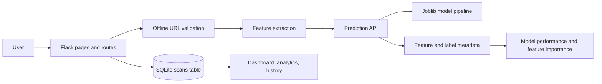

# Cyber Hacking Breaches Prediction and Detection

**Project type:** Final-year academic prototype  
**Application:** Offline URL screening and local scan dashboard  
**Current status:** Flask application runs locally with a trained Random Forest using 13 offline URL-text features. The dataset's other 74 page-content and external-service signals are not used.

> **Scope and safety:** This project inspects the text of a submitted URL. It does not open the URL, follow redirects, download page content, check domain reputation, or query live threat-intelligence feeds. A future model score must be treated as an estimate, not proof that a site is safe.

## 1. Project introduction

Phishing links are commonly used to direct people to fraudulent pages that request credentials, payment details, or other sensitive information. This project provides an academic prototype for analyzing URL characteristics and presenting a screening result through a Flask web application. It also records completed predictions in a local SQLite database for review.

The repository contains the larger labeled dataset and a smaller synthetic demonstration file. The model trains on features recomputed from the larger dataset's raw URLs, so training and prediction share the same safe, offline extractor. It does not claim to reproduce the dataset's full 87 precomputed features.

## 2. Abstract

This project is designed to investigate phishing URL classification using supervised machine learning, with a Random Forest classifier as the proposed algorithm. The planned workflow validates a submitted URL, extracts the same ordered features used during training, predicts a phishing or legitimate class, and presents the estimated class probabilities and a risk category in a Flask interface. SQLite is used to retain completed scan results and support dashboard statistics and searchable history.

The implementation includes URL validation, an offline 13-feature extractor, a Random Forest trained on the dataset's raw URLs and labels, a prediction API, the Flask interface, and automated tests. The model artifacts and evaluation figures are generated locally. The 87 precomputed feature values are excluded because their complete inference definitions are unavailable and some require page or external-service data.

## 3. Problem statement

Users may receive URLs that imitate trusted brands or use misleading hostnames and paths. Manual inspection is inconsistent and may not reveal subtle structural patterns. The project aims to create a repeatable workflow that can examine URL-derived features and support a user’s decision to investigate a link further.

The system is a screening aid. It cannot establish that a site is safe, confirm page behavior, or replace browser protection, security operations, or human verification.

## 4. Existing system

Common baseline approaches include manual URL inspection, browser warnings, allow/block lists, and rule-based checks for suspicious URL strings. These approaches can be useful, but they depend on user attention, known indicators, and update coverage.

## 5. Disadvantages of existing system

- Manual inspection can miss deceptive subdomains, URL credentials, or unfamiliar domains.
- Blocklists may not contain newly registered or previously unseen phishing URLs.
- Fixed rules can miss patterns they were not designed to detect and can flag benign URLs.
- A classification or warning does not explain all contextual signals or verify page content.

These are general limitations of the approaches, not measured comparisons from this project.

## 6. Proposed system

The proposed system provides a local Flask interface for URL screening. It validates input, extracts URL features without network access, passes features to a saved model when its metadata and feature schema match, displays a class and estimated probability, and stores successful results in SQLite. Dashboard charts summarize recorded scans; model evaluation and feature-importance views read saved training metadata.

At present, the feature schema check prevents a prediction because the prototype extractor defines 13 fields while the selected dataset contains 87 extracted model features.

## 7. Advantages of the proposed system

- URL inspection does not contact the submitted destination.
- Feature ordering and dataset label mappings are checked before prediction.
- Model training uses the shared URL-text extractor when raw URL values are available; it refuses incompatible feature-only inputs.
- Dashboard statistics are derived from successful SQLite records.
- Search and reporting are local to the application database.
- The interface communicates that model probabilities are estimates.

These are design and implementation properties; no detection-rate improvement has been measured.

## 8. Hardware requirements

The following is a practical development baseline, not a benchmarked performance requirement:

- 64-bit Windows, macOS, or Linux computer.
- Dual-core processor or better.
- 4 GB RAM minimum; more memory is recommended for a full dataset and cross-validation.
- Approximately 1 GB of free disk space for a virtual environment, dependencies, dataset, and model artifacts. Actual needs depend on installed packages and dataset size.
- Internet access is needed to install Python packages, but the application itself does not need network access to analyze URLs.

## 9. Software requirements

- Python 3.10 or newer.
- Flask 3.x.
- pandas, NumPy, scikit-learn, Joblib, and Matplotlib.
- pytest for the development test suite.
- SQLite, included with Python's standard library.
- A modern browser for the local web interface.

Exact package ranges are listed in [`requirements.txt`](requirements.txt) and test dependencies in [`requirements-dev.txt`](requirements-dev.txt).

## 10. System architecture



Model and metadata nodes are not currently populated with compatible artifacts. The web pages and database routes can still start and render empty states.

## 11. Dataset description

The main CSV is the *Web page phishing detection* dataset by Abdelhakim Hannousse and Salima Yahiouche, version 3, DOI [10.17632/c2gw7fy2j4.3](https://data.mendeley.com/datasets/c2gw7fy2j4/3), licensed CC BY 4.0. The project retains the source attribution when redistributing the dataset.

Two CSVs are present in `dataset/`. The detailed comparison is saved in [`dataset/inspection_report.txt`](dataset/inspection_report.txt); `python -m src.data_preprocessing` regenerates the machine-readable report at [`reports/dataset_inspection.json`](reports/dataset_inspection.json).

| Observed property | Actual value |
|---|---:|
| File | `dataset_phishing.csv` |
| Rows and columns | 11,430 × 89 |
| Target column and values | `status`: `legitimate` and `phishing`, 5,715 each |
| Other columns | One raw URL column plus 87 numeric precomputed feature columns |
| Missing values / duplicate records | 0 / 0 |

The second file, `phishing_dataset.csv`, is a small synthetic sample with 60 rows, `url` and `label` columns, and 30 examples per numeric label. It is not suitable for the requested model.

The 11,430-row file includes 87 precomputed numeric columns. This model does not feed those columns into training. Instead it recomputes the same 13 URL-text signals from every raw URL and trains against the dataset's `status` labels. Three raw URLs contained literal whitespace; training percent-encoded those characters and records the source CSV row numbers in `models/feature_metadata.json`. The resulting model can analyze new URL text offline, but it does not analyze page content, domain registration, traffic, DNS, or reputation.

## 12. Feature extraction

The current prototype in [`src/feature_extraction.py`](src/feature_extraction.py) exposes 13 ordered lexical signals:

| Feature | Prototype calculation |
|---|---|
| `url_length` | Character count of the normalized URL. |
| `hostname_length` | Character count of the parsed hostname. |
| `uses_https` | 1 when scheme is HTTPS; otherwise 0. |
| `has_ip_host` | 1 when hostname parses as an IP address; otherwise 0. |
| `num_dots` | Dot count in the hostname. |
| `num_hyphens` | Hyphen count in the URL. |
| `num_at` | `@` count in the URL. |
| `num_digits` | Count of numeric characters in the URL. |
| `num_subdomains` | Number of hostname labels beyond the final two labels, floored at zero. |
| `has_suspicious_word` | 1 when the host, path, or query contains a word from the prototype list; otherwise 0. |
| `has_port` | 1 when an explicit valid port is present; otherwise 0. |
| `has_path` | 1 when path is not empty or `/`; otherwise 0. |
| `has_query` | 1 when a query string is present; otherwise 0. |

This list is **not equivalent to the unknown 87 training features**. The actual extraction code or documentation and exact feature order must be supplied before training or prediction can be enabled. The URL validator accepts HTTP/HTTPS only, rejects malformed input, and never makes a network request.

## 13. Random Forest algorithm

Random Forest is the selected supervised-learning algorithm. It combines predictions from multiple decision trees; for classification, the forest’s output is based on votes across trees, with class probabilities available from the fitted estimator. The planned training implementation uses a reproducible random state, stratified 80:20 train-test splitting, preprocessing inside a scikit-learn pipeline, and cross-validation parameter search on the training partition. The held-out test partition is reserved for final evaluation.

These describe the implementation plan and training code. **No Random Forest has been trained on the downloaded dataset.** The training module rejects the 13-feature/schema mismatch rather than producing misleading metrics.

## 14. Flask implementation

`app.py` connects the scanner, prediction module, SQLite storage, and dashboard pages. The interface includes:

- Home and URL scanner pages.
- Prediction result page with estimated phishing probability, risk category, and recommendation when artifacts are available.
- Overview dashboard with scan totals, class distribution, daily activity, and recent records.
- Threat analytics based on SQLite scan records.
- Model performance and feature importance based on saved model metadata.
- Searchable scan history and project information.

Forms use CSRF tokens; database writes use parameterized SQL; templates use Jinja autoescaping; submitted URLs are not executed or fetched. The local development server binds to `127.0.0.1:5000` with debug mode disabled.

## 15. Database design

The application creates `database/security.db` and a `scans` table:

| Column | Purpose |
|---|---|
| `scan_id` | Integer primary key for a completed scan. |
| `submitted_url` | URL text entered by the user. |
| `prediction` | `Phishing` or `Legitimate`. |
| `phishing_probability` | Estimated probability from 0 to 1, when available. |
| `risk_category` | Presentation band: Low, Medium, or High Risk. |
| `timestamp` | ISO timestamp recorded in UTC. |

Only successful model predictions are stored. Invalid input and unavailable-model responses do not create scan rows. The database created during testing contains the schema but no fabricated prediction records.

## 16. Installation instructions

In Windows PowerShell, from the project directory:

```powershell
py -3.10 -m venv .venv
.\.venv\Scripts\Activate.ps1
python -m pip install --upgrade pip
pip install -r requirements-dev.txt
```


## 17. Execution instructions

Start the web application:

```powershell
python app.py
```

Open <http://127.0.0.1:5000>. To inspect CSV data and regenerate the dataset report:

```powershell
python -m src.data_preprocessing
```

Train or rebuild the compatible URL-text model (this does not visit any dataset URLs):

```powershell
python -m src.model_training
```

The trained model is saved to `models/random_forest_model.pkl`, with feature order and measured evaluation results in `models/feature_metadata.json`. The generated confusion matrix, feature-importance chart, and text report are in `reports/`.

To run the automated test suite:

```powershell
python -m pytest -p no:cacheprovider --basetemp=.pytest-work -q
```

For a persistent Flask session key, set a private `FLASK_SECRET_KEY` environment variable before starting the app. If not set, a process-local key is generated and sessions do not persist across restarts.

## 18. Testing results

The most recent run used Python 3.11 and pytest 9.2.0. Result: **37 passed**. Tests cover imports, both CSVs, preprocessing and stratified splitting, URL validation and feature order, model training/saving/loading, URL prediction, Flask routes, CSRF and size limits, SQLite scan storage, dashboard/history rendering, model charts, and responsive-layout markers.

Additional live HTTP smoke check: the server is running on `127.0.0.1:5000`; `/scan` and `/model-performance` return HTTP 200. An isolated Flask test-client submission for `https://example.com` returned HTTP 200 with a real model result; dashboard and history pages returned HTTP 200. Responsive behavior was checked through stylesheet and markup assertions, not browser/device emulation.

## 19. Actual model evaluation metrics

Measured on a stratified 80:20 split of the 11,430 labeled URLs with random state 42. The model used 13 URL-text features recomputed using the inference extractor; precomputed dataset features were excluded. No parameter search was run.

| Metric | Held-out result |
|---|---:|
| Training accuracy | 95.14% |
| Testing accuracy | 82.68% |
| Phishing precision | 83.80% |
| Phishing recall | 81.01% |
| Phishing F1-score | 82.38% |

Confusion matrix (rows actual, columns predicted; label order legitimate, phishing): `[[964, 179], [217, 926]]`. Full results are in [`reports/model_evaluation.txt`](reports/model_evaluation.txt); charts are generated under `reports/`.

## 20. Limitations

- The large dataset is present, but the definitions for its 87 precomputed feature values are absent.
- The second dataset is a 60-row synthetic sample and is unsuitable for model evaluation.
- The model uses 13 lexical URL signals, not all 87 precomputed dataset features.
- URL-only signals cannot inspect page content, reputation, redirects, or live behavior.
- Even with a compatible model, URL-only lexical analysis cannot inspect page content, reputation, redirects, or live behavior.
- Model probabilities and risk bands would need calibration and validation on representative data before any operational use.
- The Flask development server and local SQLite setup are intended for academic/local use, not production deployment.

## 21. Future enhancements

1. Obtain and validate the original extraction definitions if the full 87-feature model is required.
2. Compare the current URL-only model against a separate time-based or external test set and assess probability calibration.
3. Add safe, privacy-aware reputation enrichment only after defining explicit network-safety controls.
4. Add database retention controls, export policy, authentication, and production deployment hardening if the application is deployed beyond localhost.
5. Capture genuine application screenshots and include the generated evaluation figures in the final report.

## 22. Conclusion

The project provides a working Flask application for offline URL screening, SQLite scan history, and SOC-style dashboards. A Random Forest trained and evaluated on URL-text signals makes live predictions using the same extractor. It is a URL-only academic screening model; it does not reproduce the full 87-feature dataset pipeline or establish that any website is safe.

## Screenshots and evaluation figures

No application screenshot files are currently included in the repository. The actual model evaluation figures are generated in `reports/`; no mock screenshots or synthetic evaluation charts are used.
